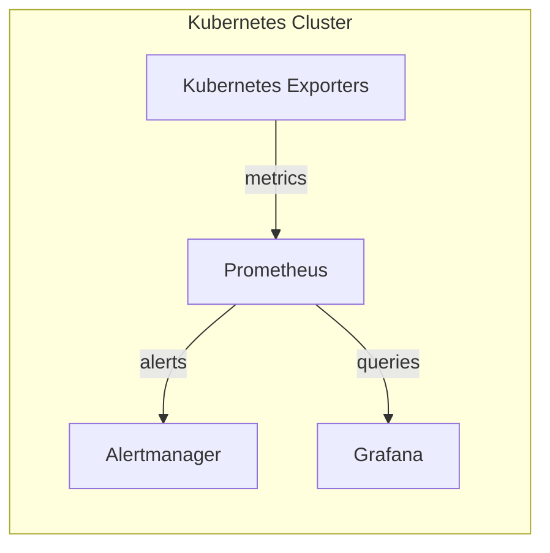

# Pyrgos

**A modular observability stack for Kubernetes.**

Pyrgos packages Prometheus, Grafana, Alertmanager, and core Kubernetes exporters into a single configurable Helm chart. It provides a reproducible monitoring foundation designed for declarative deployments and GitOps workflows.

> [!IMPORTANT]
> Pyrgos is under active development. The first chart release has not yet been published. Installation steps and configuration options are subject to change.

## Components

| Component | Purpose |
| --- | --- |
| Prometheus | Metrics collection, storage, and querying |
| Grafana | Dashboards and visualization |
| Alertmanager | Alert grouping, routing, and notifications |
| Kubernetes exporters | Node, kube-state, and workload metrics |

## Architecture

## Design goals

- **Reproducible** — declarative Helm packaging suitable for GitOps tools such as Argo CD
- **Configurable** — centralized values interface for the full stack
- **Standard** — upstream Prometheus, Grafana, and Alertmanager components

## Prerequisites

- Kubernetes cluster
- Helm 3

## Status

Installation instructions and example values will be published with the initial chart release.

## Contributing

Contributions, bug reports, and feature requests are welcome.

Please open an issue before proposing significant architectural changes. Contribution guidelines will be added as the project matures.

## License

License to be determined. An OSI-approved license will be selected before the first public release.
